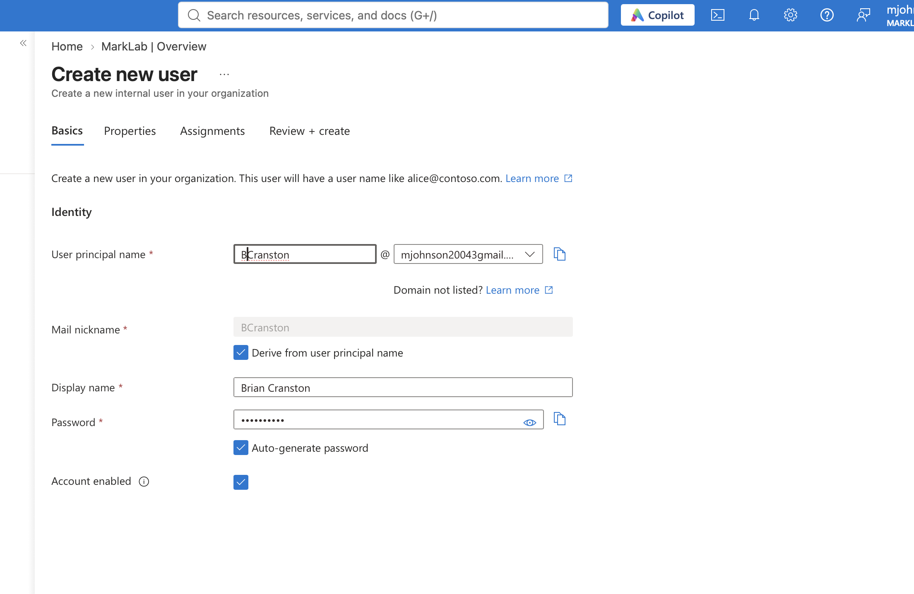
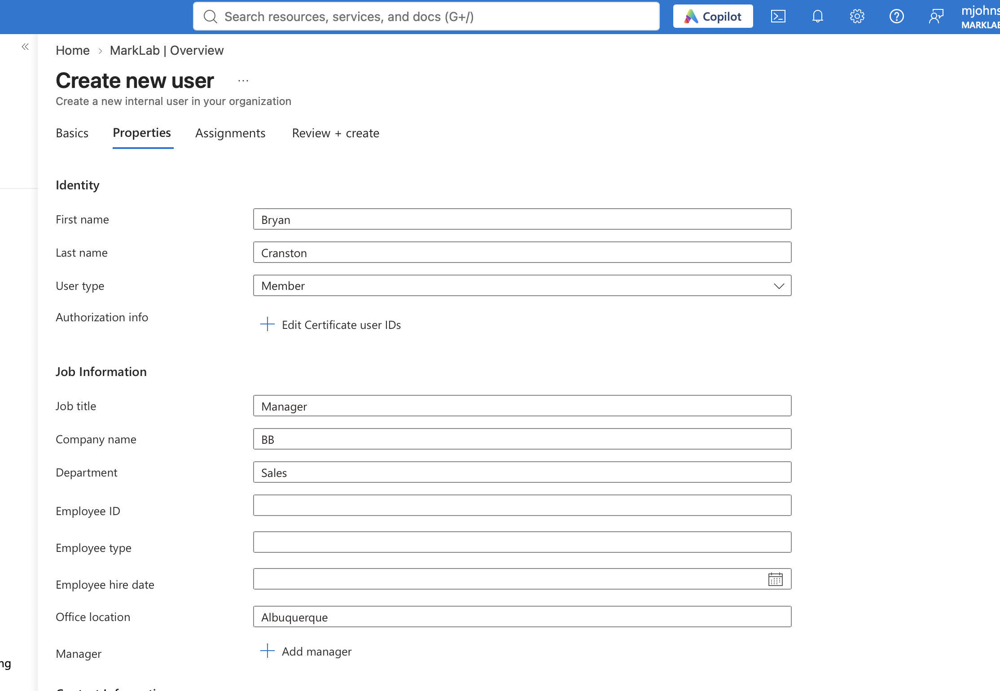
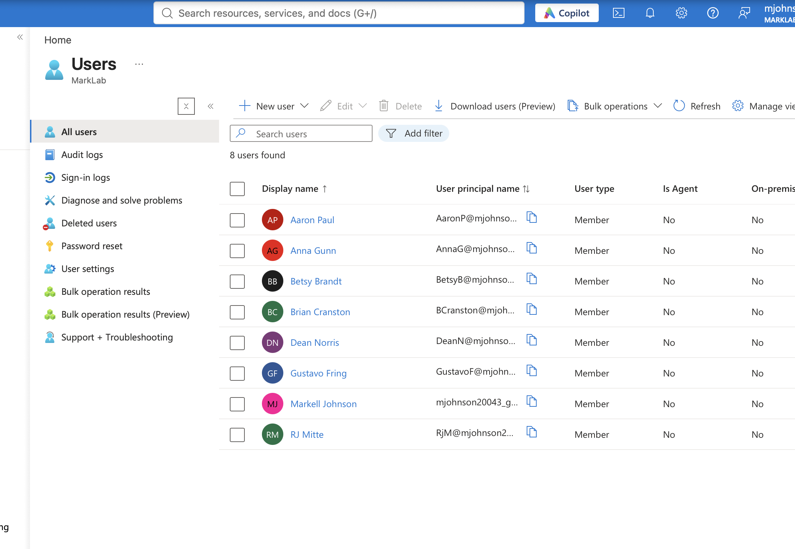
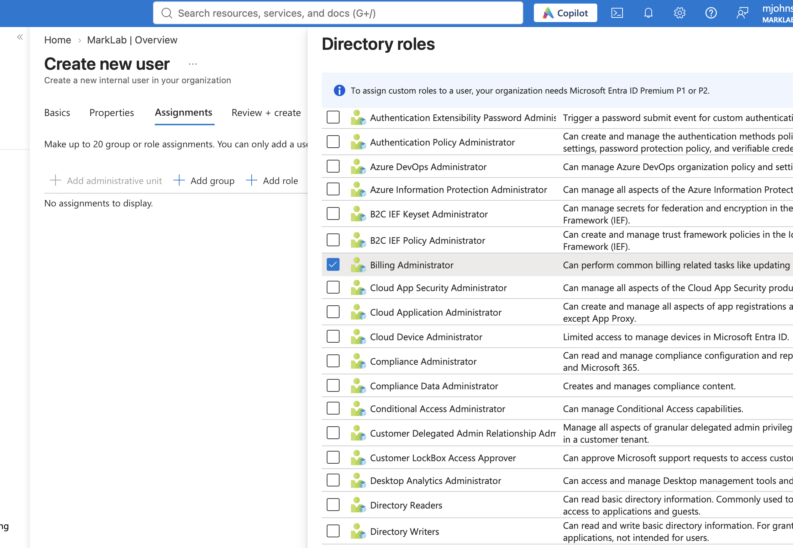
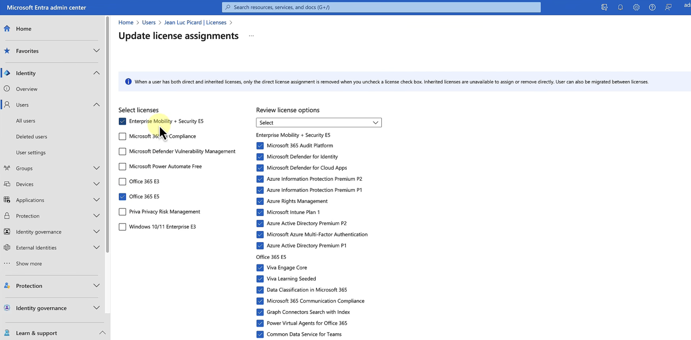
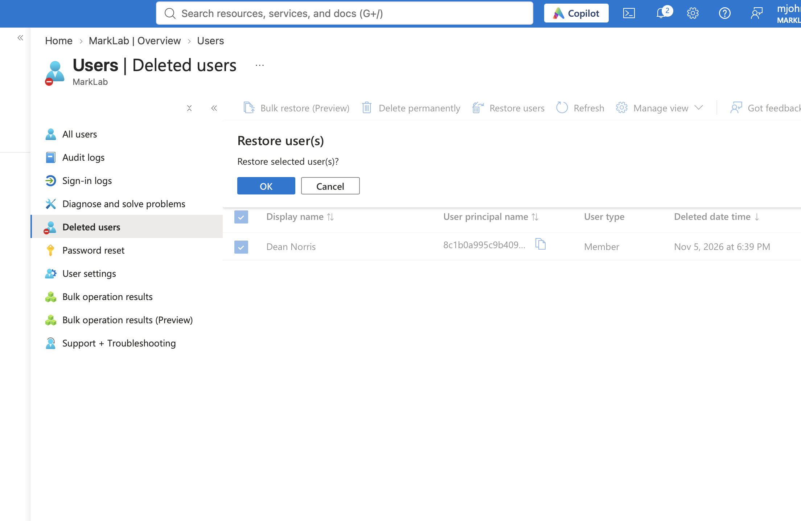
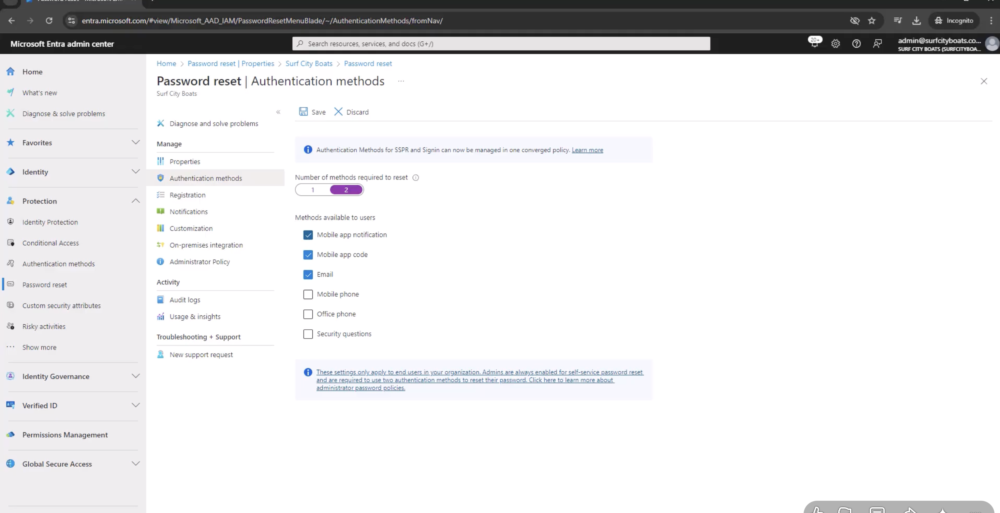
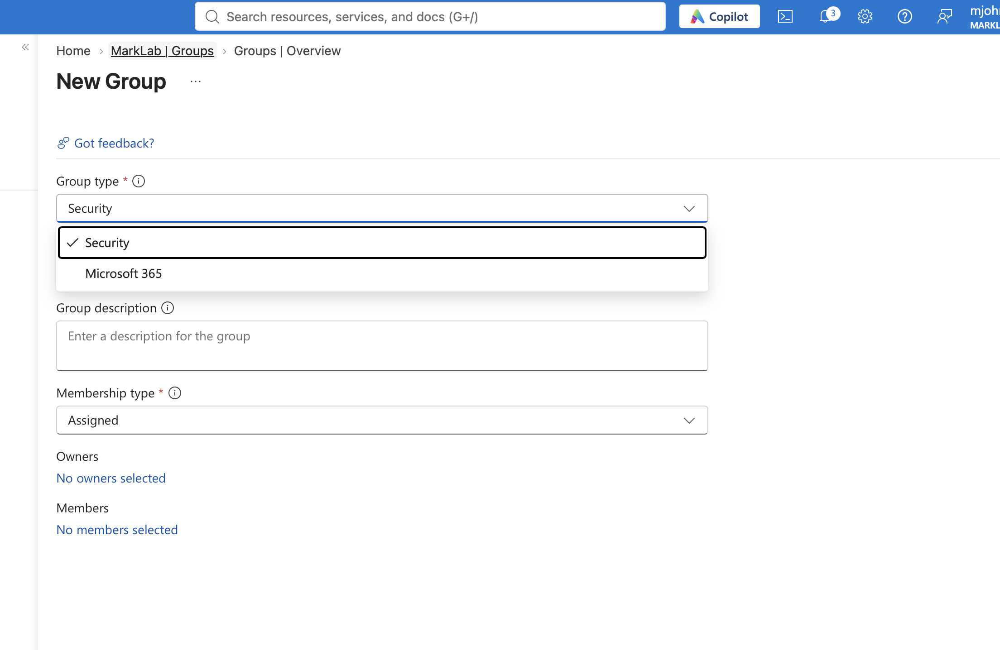

# Azure Active Directory Practice – Documentation

This documentation covers the steps I completed while practicing user management, administrative roles, licensing, group management, and security settings in Microsoft Azure Active Directory (Microsoft Entra ID).

## Technologies Used

- Microsoft Azure Portal
- Microsoft Entra ID (formerly Azure Active Directory)
- User and Identity Management
- Administrative Directory Roles
- Microsoft 365 Licensing
- Security Groups and Microsoft 365 Groups
- Dynamic Group Membership
- Self-Service Password Reset (SSPR)
- Tenant Security Defaults

## 1. Creating a New User

The first step was creating a new user account within my Azure tenant.

1. Navigate to **Microsoft Entra ID** in the Azure portal.
2. Select **Users** from the left-hand menu.
3. Click **New user**, then select **Create new user**.
4. Enter the user's basic information, including their username, display name, and password.
5. Review the account information and create the user.

This creates a new user account that can be managed through the Azure portal.

### 1.1 Configuring User Properties

After creating the account, I explored the user's properties and additional information.

1. Open the newly created user account.
2. Navigate to the **Properties** section.
3. Review and configure available information, such as first name, last name, job title, department, and company.
4. Save any changes made to the user's properties.

These properties help organize user accounts and can also be used when creating dynamic group membership rules.

### 1.2 Reviewing Created Users

After creating accounts, I returned to the Users section to review the accounts within my tenant.

This allowed me to verify that the accounts were successfully created and view the available user information.

## 2. Assigning Administrative Roles

Administrative roles determine what actions a user can perform within the Azure tenant.

1. During user creation, navigate to the **Assignments** section.
2. Select **Add role**.
3. Review the available directory roles.
4. Select the appropriate administrative role based on the responsibilities of the user.
5. Complete the user creation process.

Using the principle of least privilege, administrators should only receive the permissions necessary to perform their assigned responsibilities.

## 3. Assigning Licenses to Users

Licenses provide users with access to Microsoft 365 services and other paid Microsoft products.

1. Navigate to the user's account in Microsoft Entra ID.
2. Open the **Licenses** section.
3. Select **Assignments**.
4. Choose the available license or services to assign.
5. Review the selections and apply the license assignment.

The available services depend on the license purchased by the organization.

## 4. Deleting and Restoring User Accounts

Deleting user accounts is useful when an employee leaves an organization or no longer requires access.

### 4.1 Deleting a User

1. Navigate to **Users** in Microsoft Entra ID.
2. Locate the account that needs to be removed.
3. Select the user account.
4. Choose the **Delete** option.
5. Confirm the deletion.

Deleted accounts are moved to the **Deleted users** section, where they can be restored during the recovery period.

### 4.2 Restoring a Deleted User

If an account is accidentally deleted, it can be restored through the Deleted users section.

1. Navigate to **Users**.
2. Select **Deleted users**.
3. Locate the account that needs to be recovered.
4. Select the user and choose **Restore user**.
5. Confirm the restoration.

Deleted user accounts can generally be restored within 30 days before permanent deletion.

## 5. Resetting User Passwords

Administrators can reset a user's password if they are unable to access their account.

1. Navigate to **Users** in Microsoft Entra ID.
2. Select the account that needs a password reset.
3. Open the user's **Overview** page.
4. Select **Reset password**.
5. Generate a temporary password.
6. Provide the temporary password to the user through an appropriate secure method.

This allows the user to regain access to their account.

### 5.1 Self-Service Password Reset

Self-Service Password Reset (SSPR) allows users to reset their own passwords without needing an administrator to perform the reset.

I explored the authentication methods and configuration options available for self-service password resets.

1. Navigate to the password reset settings in Microsoft Entra ID.
2. Review the authentication methods available for users.
3. Review the configuration options for self-service password resets.

These settings help organizations provide users with a way to recover access to their accounts.

## 6. Creating and Managing Groups

Groups help organize users and manage access to resources within an organization.

### 6.1 Choosing a Group Type

When creating a new group, Azure provides different group types depending on their intended purpose.

1. Navigate to **Groups** in Microsoft Entra ID.
2. Select **New group**.
3. Review the available group types.
4. Choose between a **Security** group and a **Microsoft 365** group.

Security groups are primarily used to manage permissions and access to resources. Microsoft 365 groups are designed for collaboration and shared Microsoft 365 resources.

### 6.2 Creating a Microsoft 365 Group

I also explored the creation of a Microsoft 365 group.

1. Navigate to **Groups**.
2. Select **New group**.
3. Choose **Microsoft 365** as the group type.
4. Review the available group settings.
5. Enter the group information and configure the available membership options.

Microsoft 365 groups provide a way to organize members around shared collaboration resources.

### 6.3 Configuring Dynamic Membership Rules

Dynamic membership rules allow users to be automatically added to or removed from a group based on their account properties.

1. Navigate to **Groups** and create or select a supported security group.
2. Review the membership type options.
3. Select **Dynamic User** membership.
4. Configure the membership rules using available user properties.
5. Review the rule configuration.

For example, a rule can use a user's department property to determine group membership. If the user's properties change and they no longer meet the rule requirements, their membership can automatically update.

## 7. Configuring Azure AD Security

Security settings help protect the tenant and its user accounts from unauthorized access.

### 7.1 Security Defaults

Security Defaults provide baseline security protections for an Azure tenant.

1. Navigate to **Microsoft Entra ID**.
2. Open the **Properties** section.
3. Locate the **Manage security defaults** option.
4. Review the available security default settings.
5. Review the current configuration.

Security Defaults help provide basic protections, including multifactor authentication requirements and restrictions on legacy authentication. Organizations with existing Conditional Access policies may use a different security configuration.

---

## Conclusion

Through this practice, I gained experience navigating Microsoft Entra ID and managing users, administrative roles, licenses, passwords, and groups. I also explored dynamic membership rules and tenant security settings.

This lab helped me better understand how cloud-based directory services are used to organize accounts, manage permissions, and maintain security within an organization.
